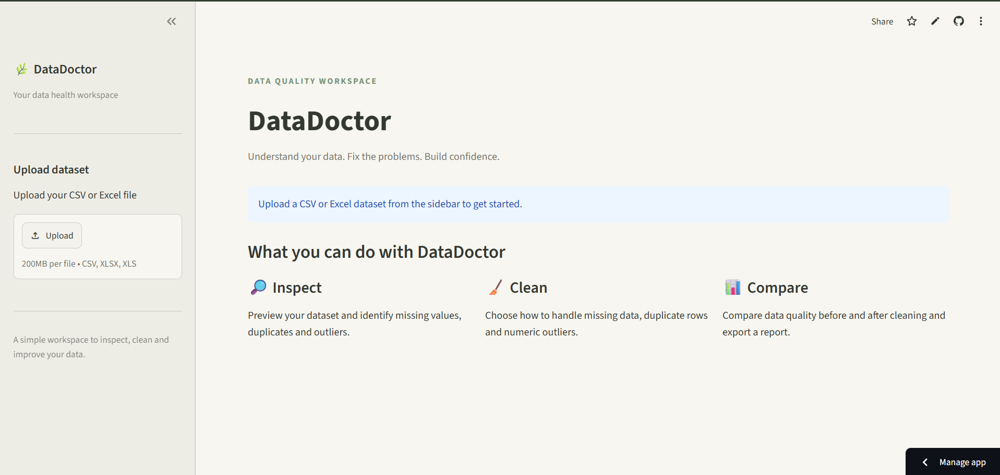
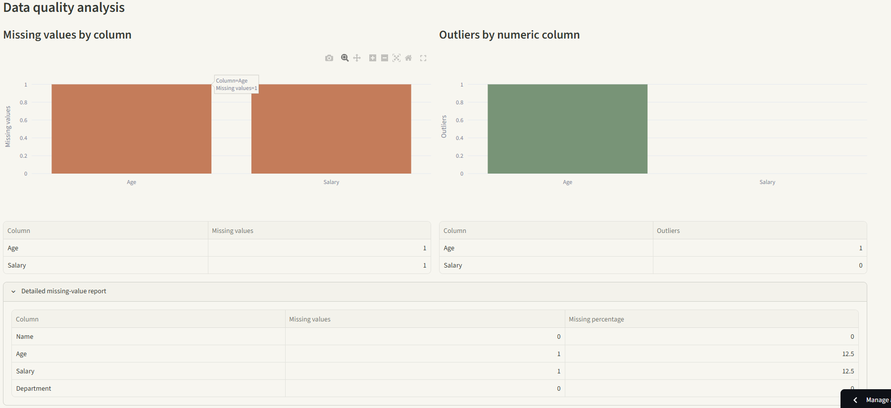

# 🩺 DataDoctor — Data Quality Analyzer

**A Streamlit-based tool to analyze, clean, and improve the quality of datasets.**

[🚀 Live Demo](https://datakadoctor.streamlit.app) · [📂 GitHub Repository](https://github.com/Pannu99yogesh/DataDoctor)

## 📌 Overview

DataDoctor is an interactive data quality analysis application built with Python and Streamlit. It helps users identify common data-quality problems, apply cleaning operations, and compare dataset quality before and after cleaning.

Upload a CSV or Excel file, explore its quality issues, choose cleaning options, and download the cleaned dataset along with a PDF quality report.
## 📸 Application Preview

### 1. Home Screen


### 2. Data Quality Analysis

## ✨ Features

- **Dataset Upload:** Supports CSV and Excel files.
- **Data Preview:** Explore uploaded datasets.
- **Missing Value Analysis:** Identify missing values across columns.
- **Duplicate Detection:** Find duplicate records.
- **Outlier Detection:** Identify potential outliers using the IQR method.
- **Data Cleaning:** Handle missing values, remove duplicates, and manage outliers.
- **Before vs. After Comparison:** Compare quality scores visually.
- **CSV Export:** Download the cleaned dataset.
- **PDF Report:** Generate a downloadable data quality report.

## 🛠️ Tech Stack

| Technology | Purpose |
|---|---|
| Python | Core programming language |
| Streamlit | Interactive web application |
| Pandas | Data manipulation and analysis |
| NumPy | Numerical operations |
| Plotly | Interactive visualizations |
| ReportLab | PDF report generation |
| OpenPyXL | Excel file support |

## 📊 Data Quality Score

DataDoctor uses a custom quality score based on missing values and duplicate records.

**Formula:**

`Quality Score = 100 × (1 − 0.7 × Missing Rate − 0.3 × Duplicate Rate)`

Where:
- Missing Rate = Missing cells / Total cells
- Duplicate Rate = Duplicate rows / Total rows

The score is a project-defined metric designed to compare datasets before and after cleaning. It is not an industry-standard quality benchmark.

## ⚙️ Run Locally

### 1. Clone the repository

```bash
git clone https://github.com/Pannu99yogesh/DataDoctor.git
```

### 2. Open the project folder

```bash
cd DataDoctor
```

### 3. Create a virtual environment

```bash
python -m venv venv
```

### 4. Activate the environment

**Windows:**

```bash
venv\Scripts\activate
```

### 5. Install dependencies

```bash
pip install -r requirements.txt
```

### 6. Run the application

```bash
streamlit run app.py
```

The application will open in your browser.

## 📁 Project Structure

```text
DataDoctor/
│
├── app.py
├── requirements.txt
├── README.md
│
├── data/
│   └── sample_data.csv
│
├── src/
│   ├── analyzer.py
│   └── cleaner.py
│
└── .streamlit/
    └── config.toml
```

## 🧪 How to Use

1. Open the [Live Demo](https://datakadoctor.streamlit.app).
2. Upload a CSV or Excel dataset.
3. Review the data quality analysis.
4. Select the cleaning operations.
5. Compare the before-and-after results.
6. Download the cleaned dataset and PDF report.

## 🎯 Project Objective

The objective of DataDoctor is to simplify the data preprocessing stage by providing an interactive tool for identifying and handling common data-quality issues.

## 👨‍💻 Author

**Yogesh Pannu**

GitHub: [Pannu99yogesh](https://github.com/Pannu99yogesh)

---

*Built with Python and Streamlit.*
